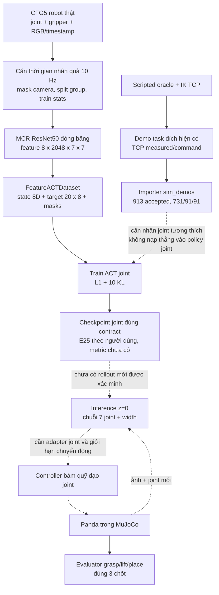

# 01 — Dự án đang làm gì và vì sao

## 1. Một câu mô tả đúng hiện tại

Nhóm xây dựng và kiểm tra pipeline học bắt chước cho robot Panda: học liên hệ giữa ảnh nhiều camera, trạng thái khớp và chuỗi tư thế khớp tương lai; mục tiêu tiếp theo là thích nghi cho gắp chốt vào khuôn, rồi đánh giá trước khi thử robot thật. **Nhánh hiện tại đã có preprocessing MCR và ghi nhận đang train, chưa có bằng chứng gắp–đặt thành công bằng joint policy.** [J/docs/PREPROCESSING_MCR_JOINT_MASKED_CHI_TIET_VI.md:27](<F:/cfg5_mophong/local_source_(1)/docs/PREPROCESSING_MCR_JOINT_MASKED_CHI_TIET_VI.md:27>) [H/chat:5754](<C:/Users/ADMIN/.codex/sessions/2026/10/09/rollout-2026-10-09T02-26-45-01a0efcd-3cdf-7091-9e7f-d7a9b07cc2c6_01a11cfb-7bc7-7242-b892-5079ec9af8d1.jsonl:5754>)

Đừng kể thành “ACT nhận ảnh là tự hiểu được toàn bộ nhà máy”. Model chỉ có observation, nhãn và distribution được cung cấp. Dữ liệu robot trong CFG5 giúp pretraining; dữ liệu bài toán khuôn vẫn cần nhãn và thí nghiệm đích tương thích.

## 2. Bài toán mô phỏng cụ thể

✅ Config task `three_color_matched_pegs` dùng **3 chốt trụ**, bán kính 3 mm, dài 35 mm, khối lượng 5 g/chốt, đặt vào 3 lỗ theo màu/ID. Lỗ bán kính 3,5 mm, sâu 12 mm. Đó là bài toán kỹ thuật thay thế trong mô phỏng, **chưa xác nhận tương đương linh kiện DENSO thật**. [J/configs/mujoco/panda_three_pegs.json:1](<F:/cfg5_mophong/local_source_(1)/configs/mujoco/panda_three_pegs.json:1>)

Khe hở đường kính là 7−6=1 mm; khe hở bán kính là **0,5 mm** khi chốt thẳng và đồng tâm. Đây là giới hạn hình học lý tưởng, không phải sai số policy đã đo được. Độ nhô mục tiêu khi chạm đáy là 35−12=**23 mm**, tolerance ±0,5 mm. Không nhầm độ nhô với vị trí z tuyệt đối trong world. [J/src/simulation/task_geometry.py:1](<F:/cfg5_mophong/local_source_(1)/src/simulation/task_geometry.py:1>) [J/src/simulation/panda_evaluator.py:6](<F:/cfg5_mophong/local_source_(1)/src/simulation/panda_evaluator.py:6>)

Evaluator yêu cầu chốt nằm đúng lỗ, bao hình học đoạn cắm không vượt thành lỗ, độ nhô đúng, đáy không treo hoặc xuyên quá mức, nghiêng ≤3°, vận tốc tịnh tiến ≤5 mm/s và góc ≤0,1 rad/s, đã nhả khỏi robot, có lực đỡ đáy ≥0,001 N, ổn định ít nhất 0,5 s. Task success còn cần lịch sử grasp hai ngón và lift ≥20 mm cho **cả 3 chốt**. Đây là tiêu chí mô phỏng đã cài, không phải chứng nhận chất lượng nhà máy. [J/src/simulation/panda_evaluator.py:65](<F:/cfg5_mophong/local_source_(1)/src/simulation/panda_evaluator.py:65>) [J/configs/mujoco/panda_three_pegs.json:1](<F:/cfg5_mophong/local_source_(1)/configs/mujoco/panda_three_pegs.json:1>)

## 3. Sơ đồ end-to-end và chỗ đang đứt



Các cạnh liền trên nhánh preprocessing có source/log. Cạnh chấm là mắt xích phải hoàn thiện/xác minh. Demo controller đọc vị trí vật privileged, trong khi policy chỉ nên đọc ảnh và trạng thái robot. [J/src/simulation/panda_demo.py:1](<F:/cfg5_mophong/local_source_(1)/src/simulation/panda_demo.py:1>) [J/src/data/cfg5_masked.py:205](<F:/cfg5_mophong/local_source_(1)/src/data/cfg5_masked.py:205>) [J/src/data/feature_cache.py:353](<F:/cfg5_mophong/local_source_(1)/src/data/feature_cache.py:353>) [J/src/models/mcr_act.py:94](<F:/cfg5_mophong/local_source_(1)/src/models/mcr_act.py:94>)

**Khoảng trống quan trọng nhất:** `PandaEnv.observation()` hiện trả state TCP 8D và `PandaController.validate_action()` vẫn hiểu 8 số là xyz+wxyz+width. Model mới cũng có 8 số nhưng là q1…q7+width. Giống shape không có nghĩa cùng ý nghĩa. Chưa thấy adapter joint rollout trong các module mô phỏng đã khảo sát. [J/src/simulation/panda_env.py:113](<F:/cfg5_mophong/local_source_(1)/src/simulation/panda_env.py:113>) [J/src/simulation/panda_controller.py:16](<F:/cfg5_mophong/local_source_(1)/src/simulation/panda_controller.py:16>)

## 4. Bản đồ thư mục và phiên bản

```text
F:/Denso/                         PowerPoint gốc + docs_denso_hack/ mới
F:/cfg5_mophong/
  AGENTS.md, README.md            quy tắc và bản đồ repo
  local_source/                   source gốc, kết quả TCP lịch sử, resume/plots mới
  local_source_(1)/               source masked joint/MCR được ghi là bản làm việc
    src/data/                     CFG5, masked timestamps, chunks, feature cache, sim importer
    src/models/                   adapter ACT và MCRACTPolicy
    src/training/                 optimizer, train/val, checkpoint/resume
    src/evaluation/               offline/transfer diagnostics
    src/simulation/               camera, scene, Panda, IK, controller, evaluator
    configs/                      config TCP gốc và task, config joint sinh trên server
    scripts/                      CLI train, preprocess, check, Slurm
    data/splits/                  split/normalization và manifest cũ/sim local
    RH20T_cfg5/                   payload gốc; chỉ lấy một record trong lượt này
    mujoco/models/                Panda Menagerie và manifest nguồn
    third_party/rh20t_act/         upstream RH20T ACT baseline được khóa commit
  checkpoints/before_test_.../     weights/history TCP cũ, không phải joint E25
  epoch5_transfer_probe_14120/     báo cáo 10 transfer rollout cũ
  *_bundle*/                      gói triển khai từng thời điểm
  server_train_mcr_current.py      snapshot trainer server đã tải về 16/10
```

Nguồn: [R/README.md:1](<F:/cfg5_mophong/README.md:1>), [R/BAN_GIAO_CODEX_CFG5_MCR_2026-10-13.md:34](<F:/cfg5_mophong/BAN_GIAO_CODEX_CFG5_MCR_2026-10-13.md:34>), [A/repo_inventory.json:1](<F:/Denso/docs_denso_hack/_audit/repo_inventory.json:1>). Đã đọc Git status, thấy thay đổi có sẵn trong `local_source/docs/DECISIONS.md` và các file resume/plot chưa commit. Lượt này không sửa chúng. Không tự chọn snapshot bundle làm source mới nhất chỉ dựa vào tên v5.

## 5. File/module → vai trò → ai gọi

Đường dẫn J/L/R được định nghĩa ở 00. Các link là đường dẫn tuyệt đối.

| File/module | Vai trò và trạng thái | Được gọi bởi |
|---|---|---|
| [J/scripts/prepare_cfg5_masked_mcr.py:19](<F:/cfg5_mophong/local_source_(1)/scripts/prepare_cfg5_masked_mcr.py:19>) | ✅ Tạo config/split/light numeric joint, ngoại lệ đúng 4 episode thiếu joint | Slurm prepare/all robot |
| [J/src/data/cfg5_masked.py:205](<F:/cfg5_mophong/local_source_(1)/src/data/cfg5_masked.py:205>) `timeline` | ✅ Ghép joint/kẹp/ảnh trên lưới 10 Hz, mask/gap segments | prepare CFG5 |
| [J/src/data/cfg5_masked.py:111](<F:/cfg5_mophong/local_source_(1)/src/data/cfg5_masked.py:111>) `restore_missing_joints` | ✅ Phục hồi joint ghi thật từ ZIP vào repairs | prepare joint khi có cờ |
| [J/src/data/splits.py:1](<F:/cfg5_mophong/local_source_(1)/src/data/splits.py:1>) | ✅ Chia theo group trước chunks | prepare CFG5/sim |
| [J/src/data/act_dataset.py:10](<F:/cfg5_mophong/local_source_(1)/src/data/act_dataset.py:10>) | ✅ Train-only normalization | prepare/light |
| [J/src/data/act_dataset.py:56](<F:/cfg5_mophong/local_source_(1)/src/data/act_dataset.py:56>) | ✅ Tạo state/action chunk/is_pad | FeatureACTDataset và trainer cũ |
| [J/src/data/staged_mcr.py:1](<F:/cfg5_mophong/local_source_(1)/src/data/staged_mcr.py:1>) | ✅ Quản lý feature-only/JPEG giai đoạn sau | prepare_mcr_cache / prepare_mcr_jpeg |
| [J/src/data/feature_cache.py:133](<F:/cfg5_mophong/local_source_(1)/src/data/feature_cache.py:133>) | ✅ Quantize feature INT8 và scale | cache builder |
| [J/src/data/feature_cache.py:353](<F:/cfg5_mophong/local_source_(1)/src/data/feature_cache.py:353>) | ✅ Loader cache frozen/full | `train_mcr_act.py` |
| [J/src/models/rh20t_act.py:34](<F:/cfg5_mophong/local_source_(1)/src/models/rh20t_act.py:34>) | ✅ Camera identity embedding, adapter 8D, loss mask | RH20TACTPolicy, MCRACTPolicy |
| [J/src/models/mcr_act.py:25](<F:/cfg5_mophong/local_source_(1)/src/models/mcr_act.py:25>) | ✅ Resize/crop ImageNet; ResNet50, freeze BN, mask camera | cache và policy |
| [J/third_party/rh20t_act/models/detr/models/detr_vae.py:34](<F:/cfg5_mophong/local_source_(1)/third_party/rh20t_act/models/detr/models/detr_vae.py:34>) | ✅ CVAE/DETRVAE core khóa upstream | adapter |
| [R/server_train_mcr_current.py:41](<F:/cfg5_mophong/server_train_mcr_current.py:41>) | ✅ Snapshot trainer mới để đối chiếu; không chạy từ root | bundle/installer server |
| [J/scripts/train_mcr_act.py:1](<F:/cfg5_mophong/local_source_(1)/scripts/train_mcr_act.py:1>) | 🟡 CLI local, không mặc định giống trainer server mới | Slurm MCR |
| [J/src/training/pretrain.py:283](<F:/cfg5_mophong/local_source_(1)/src/training/pretrain.py:283>) | ✅ `run_epoch`, train hoặc posterior validation | trainer MCR/TCP |
| [L/scripts/resume_mcr_with_plots.py:13](<F:/cfg5_mophong/local_source/scripts/resume_mcr_with_plots.py:13>) | ✅ Chuẩn bị tiếp đúng joint checkpoint và runtime | Slurm resume E100 |
| [L/src/evaluation/mcr_epoch_plots.py:1](<F:/cfg5_mophong/local_source/src/evaluation/mcr_epoch_plots.py:1>) | 🟡 Đồ thị loss và z=0 trên đoạn val cố định, chưa có log plot run mới | trainer patched sau epoch |
| [J/src/data/sim_demos.py:68](<F:/cfg5_mophong/local_source_(1)/src/data/sim_demos.py:68>) | ✅ Import demo pre-step measured TCP/command; loại thất bại | prepare_finetune_data.py / MP4 prepare |
| [J/src/data/mp4_dataset.py:1](<F:/cfg5_mophong/local_source_(1)/src/data/mp4_dataset.py:1>) | ✅ Đọc sim qua cache MP4 theo episode | trainer fine-tune TCP cũ |
| [J/configs/mujoco/panda_three_pegs.json:1](<F:/cfg5_mophong/local_source_(1)/configs/mujoco/panda_three_pegs.json:1>) | ✅ Hình học task, tần số, giới hạn và evaluator | builder/PandaEnv |
| [J/src/simulation/camera_rig.py:1](<F:/cfg5_mophong/local_source_(1)/src/simulation/camera_rig.py:1>) | ✅ Đọc calibration/rig | scene builder |
| [J/src/simulation/scene_builder.py:1](<F:/cfg5_mophong/local_source_(1)/src/simulation/scene_builder.py:1>) | ✅ Xây scene, không sửa Panda XML gốc | `build_panda_scene.py`, PandaEnv khi stale |
| [J/src/simulation/panda_env.py:12](<F:/cfg5_mophong/local_source_(1)/src/simulation/panda_env.py:12>) | ✅ Môi trường, render, physics, observation TCP | demo/transfer probe |
| [J/src/simulation/panda_controller.py:42](<F:/cfg5_mophong/local_source_(1)/src/simulation/panda_controller.py:42>) | ✅ Damped least-squares IK TCP → joint actuator | PandaEnv.step |
| [J/src/simulation/panda_demo.py:1](<F:/cfg5_mophong/local_source_(1)/src/simulation/panda_demo.py:1>) | ✅ Oracle demo dùng object state | run_pick_place_demo/evaluate_mujoco |
| [J/src/simulation/panda_observation.py:5](<F:/cfg5_mophong/local_source_(1)/src/simulation/panda_observation.py:5>) | ✅ Adapter observation TCP cũ | transfer probe TCP |
| [J/src/simulation/panda_evaluator.py:65](<F:/cfg5_mophong/local_source_(1)/src/simulation/panda_evaluator.py:65>) | ✅ Chấm đúng lỗ, grasp/lift, release/support/stability | PandaEnv |
| [J/scripts/evaluate_mujoco.py:13](<F:/cfg5_mophong/local_source_(1)/scripts/evaluate_mujoco.py:13>) | ✅ Chỉ nhận mode controller trong file này | CLI engineering smoke |
| [J/src/evaluation/transfer_probe.py:1](<F:/cfg5_mophong/local_source_(1)/src/evaluation/transfer_probe.py:1>) | ✅ Thử transfer E5 TCP, có report 0/10 | probe_epoch5.py |

Bộ ghi demo hàng loạt 8 MP4 và toàn bộ generator domain randomization chưa được truy nguyên đầy đủ trong source repo này. Có importer, manifest và ảnh minh họa, không tự gán `run_pick_place_demo.py` thành generator đã tạo đủ 1.000 demo. 🟡 **CHƯA XÁC MINH** generator đúng phiên bản cho cả tập.

## 6. Vì sao imitation learning?

**Lý do thiết kế, chưa phải kết luận thắng baseline:** nhóm có trajectory mẫu và muốn giảm công viết logic cho các biến thể. IL biến mẫu observation/action thành bài toán học có giám sát, dễ bắt đầu hơn việc tự thiết kế reward và khám phá an toàn trong RL. Chọn joint mới nhằm tận dụng joint ghi thật khi TCP thiếu, không phải vì joint luôn tốt hơn TCP. [H/chat:3568](<C:/Users/ADMIN/.codex/sessions/2026/10/09/rollout-2026-10-09T02-26-45-01a0efcd-3cdf-7091-9e7f-d7a9b07cc2c6_01a11cfb-7bc7-7242-b892-5079ec9af8d1.jsonl:3568>) [J/docs/PREPROCESSING_MCR_JOINT_MASKED_CHI_TIET_VI.md:27](<F:/cfg5_mophong/local_source_(1)/docs/PREPROCESSING_MCR_JOINT_MASKED_CHI_TIET_VI.md:27>)

Teach pendant và vision cổ điển có lợi thế khi cell ổn định, ít mã linh kiện và dung sai kiểm soát được. IL phải trả chi phí dữ liệu, calibration, retrain và chứng minh tổng quát hóa. RL có thể tối ưu qua tương tác nhưng thêm khó khăn reward, sample cost và sim fidelity. Đây là phân tích lựa chọn kỹ thuật, không có benchmark nhóm đã đo giữa các phương pháp. [ACT paper](https://roboticsproceedings.org/rss19/p016.html), [DAgger paper](https://proceedings.mlr.press/v15/ross11a.html), truy cập 17/10/2026.

## 7. Dòng thời gian quyết định

| Mốc | Đã thử / vấn đề / quyết định | Bằng chứng và giới hạn |
|---|---|---|
| 27–30/09 | Chọn RH20T ACT baseline, Panda Menagerie, 8 camera; ban đầu dùng TCP xyz+wxyz+width | [L/docs/DECISIONS.md:1](<F:/cfg5_mophong/local_source/docs/DECISIONS.md:1>) và lịch sử trong [A/history_hits.json:1](<F:/Denso/docs_denso_hack/_audit/history_hits.json:1>). README thời điểm này nói “chưa train”, không phải hiện trạng 16/10. |
| Cuối 09/2026 | Sửa placement chống false success: độ nhô 23 mm, lực đỡ, nhả robot | [L/docs/PLACEMENT_LOGIC_REVIEW_VI.md:1](<F:/cfg5_mophong/local_source/docs/PLACEMENT_LOGIC_REVIEW_VI.md:1>). Controller 3 seeds đạt, không ACT. |
| 02–07/10 | Train TCP, tối ưu batch/workers/prefetch trên A100; E58 min validation, lịch sử lưu tới E78 | [R/checkpoints/before_test_20261007_142338/history.json:1](<F:/cfg5_mophong/checkpoints/before_test_20261007_142338/history.json:1>). Batch đổi giữa run; không gọi đây là one-episode overfit test. |
| 08/10 | Chuẩn bị dữ liệu sim/fine-tune TCP, dùng measured state và command cùng tick; smoke từ E58 có log | [J/src/data/sim_demos.py:68](<F:/cfg5_mophong/local_source_(1)/src/data/sim_demos.py:68>), [A/verified_chat_messages.json:1](<F:/Denso/docs_denso_hack/_audit/verified_chat_messages.json:1>) (tin 08/10 16:53 UTC). Chưa thấy report fine-tune hoàn chỉnh. |
| 09/10 | E5 transfer 10 val demo: offline sai lệch lớn, closed-loop 0/10; chọn MCR thay backbone ảnh cũ | [R/epoch5_transfer_probe_14120/report.json:1](<F:/cfg5_mophong/epoch5_transfer_probe_14120/report.json:1>), [L/docs/DECISIONS.md:1](<F:/cfg5_mophong/local_source/docs/DECISIONS.md:1>). Không quy toàn bộ lỗi cho backbone vì chưa ablation. |
| 11/10 | TCP thiếu; FK audit góc lệch ~17°; bạn chốt joint thật, giữ episode thiếu camera, bỏ lọc rating | [H/chat:3568](<C:/Users/ADMIN/.codex/sessions/2026/10/09/rollout-2026-10-09T02-26-45-01a0efcd-3cdf-7091-9e7f-d7a9b07cc2c6_01a11cfb-7bc7-7242-b892-5079ec9af8d1.jsonl:3568>), [J/src/data/cfg5_masked.py:205](<F:/cfg5_mophong/local_source_(1)/src/data/cfg5_masked.py:205>). Không gọi FK đó đã chuẩn. |
| 12/10 | Phục hồi joint từ archive; 4 episode còn thiếu được duyệt loại; split mới 1053/132/132; dropout 0,1 | [H/chat:4085](<C:/Users/ADMIN/.codex/sessions/2026/10/09/rollout-2026-10-09T02-26-45-01a0efcd-3cdf-7091-9e7f-d7a9b07cc2c6_01a11cfb-7bc7-7242-b892-5079ec9af8d1.jsonl:4085>) [H/chat:4276](<C:/Users/ADMIN/.codex/sessions/2026/10/09/rollout-2026-10-09T02-26-45-01a0efcd-3cdf-7091-9e7f-d7a9b07cc2c6_01a11cfb-7bc7-7242-b892-5079ec9af8d1.jsonl:4276>), [R/BAN_GIAO_CODEX_CFG5_MCR_2026-10-13.md:76](<F:/cfg5_mophong/BAN_GIAO_CODEX_CFG5_MCR_2026-10-13.md:76>). |
| 13/10 | Feature-only MCR cache hoàn tất, 1317 episode/574493 tick, không JPEG | Attachment cache log ở 00; [R/BAN_GIAO_CODEX_CFG5_MCR_2026-10-13.md:19](<F:/cfg5_mophong/BAN_GIAO_CODEX_CFG5_MCR_2026-10-13.md:19>). |
| 16/10 | Bạn báo joint train tới E25; yêu cầu E100 và đồ thị sau mỗi epoch | [H/chat:5754](<C:/Users/ADMIN/.codex/sessions/2026/10/09/rollout-2026-10-09T02-26-45-01a0efcd-3cdf-7091-9e7f-d7a9b07cc2c6_01a11cfb-7bc7-7242-b892-5079ec9af8d1.jsonl:5754>) [H/chat:5810](<C:/Users/ADMIN/.codex/sessions/2026/10/09/rollout-2026-10-09T02-26-45-01a0efcd-3cdf-7091-9e7f-d7a9b07cc2c6_01a11cfb-7bc7-7242-b892-5079ec9af8d1.jsonl:5810>). Số epoch/loss độc lập chưa đọc được. |
| 16/10 cuối chat | Job 14598 pending afterany 14597, sau đó bạn yêu cầu hủy | [A/latest_thread_snapshot.json:1](<F:/Denso/docs_denso_hack/_audit/latest_thread_snapshot.json:1>), turn IDs ở 00. Chỉ có lệnh hủy được hướng dẫn, chưa thấy scheduler xác nhận. |

## 8. Hiện trạng có thể bảo vệ

✅ Mô phỏng/controller/evaluator kỹ thuật tồn tại. ✅ ACT TCP lịch sử đã train và đã có transfer test thất bại được ghi lại. ✅ Pipeline joint/MCR có cache và synthetic freeze check. 🟡 Joint training tới E25 theo lời bạn, thiếu metric/artifact mới. 🟡 Dữ liệu sim tồn tại nhưng vẫn TCP; cần nối nhãn joint đúng nghĩa. ⬜ Chứng minh learned joint policy gắp thành công, few-shot, robot thật và lợi ích kinh tế đo thật.

## Tự kiểm tra: 5 câu hỏi tôi nên trả lời được

1. Vật và khuôn mô phỏng có kích thước gì, chấm đặt đúng ra sao?
2. Vẽ lại pipeline và đánh dấu hai chỗ chưa nối của nhánh joint.
3. Model mới và controller hiện có cùng 8D nhưng khác nhau ở đâu?
4. Vì sao đổi sang joint ngày 11/10, có dùng FK làm nhãn không?
5. Chỉ ra ba bằng chứng đã làm và ba kết quả còn phải đo.
